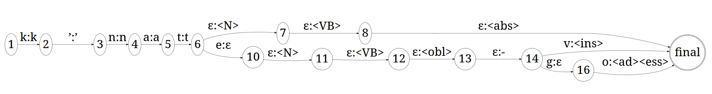

# About me

## About our lab and myself

- head of the Linguistic Convergence Laboratory, HSE
  - languages of the Caucasus, Slavic languages, and others
  - combining field and computational methods
  - see our resource page: [lingconlab.ru](lingconlab.ru)
    - Audio Corpora of minority languages of Russia
    - Russian Dialect corpora
    - Corpora of bilingual Russian
    - [Typological Atlas of the Languages of Daghestan](https://lingconlab.ru/tald/)
    - ... and others

. . .

- field linguist
  - 33 linguistic expeditions (mainly to West and East Caucasian languages)

. . .
  
- computational linguist
  - phonetician in past
  - teaching statistics and computational morphology
  - R enthusiast
    - [`lingtypology`](https://ropensci.github.io/lingtypology/)
    - [`phonfieldwork`](https://docs.ropensci.org/phonfieldwork/)
    - [`lingglosses`](https://agricolamz.github.io/lingglosses/)
    - [`RCaucTile`](https://lingconlab.github.io/RCaucTile/)

# What is FST?

## What is a finite-state transducer?

A **finite-state transducer (FST)** is a finite-state machine that reads one
sequence of symbols and produces another. In morphological analysis, it can map between
orthographic form of a word and its linguistic glossing, such as

- `children's` $\leftrightarrow$ `child.N.pl-gen`

. . .

To be honest, it is not so useful for English.

. . .

Finite-state transducer can be used in order to create rule based morphological parsers. A parser built with these tools can handle both analyzing and generating forms within the same set of rules.

## Simplified example from Tsova Tush, bbl, bats1242

On practice FST based morphological parsers produce both machine and human readable version of linguistic knowledge: 

\scriptsize
```
PATTERNS

Nouns_Abs
Nouns_Obl [>:>] Inflection
Nouns_Pl
Nouns_Pl_Obl [>:>] Inflection
...

LEXICON Inflection
<ins>:v
...
<ad><ess>:go
...

LEXICON Nouns_Abs
kʼnat<N><VB><abs>:kʼnat                           # boy, son
...
LEXICON Nouns_Obl
kʼnat<N><VB><obl>:kʼnate                          # boy, son
...
```

## Simplified example from Tsova Tush, bbl, bats1242

This will generate some forms including:

- kʼnat $\leftrightarrow$ kʼnat.N.VB.abs
- kʼnate-v $\leftrightarrow$ kʼnat.N.VB.obl-ins
- kʼnate-go $\leftrightarrow$ kʼnat.N.VB.obl-ad.ess

## Simplified example from Tsova Tush, bbl, bats1242

This example is stored in FST as a table, but can be represented as a graph:

```{r}
#| eval: false
DiagrammeR::grViz({
'digraph FST {
  graph [rankdir = LR, splines = true]
  node [fontname = "Noto Serif", fontsize = 60]
  edge [fontname = "Noto Serif", fontsize = 60, arrowsize = 1]
  qf [shape = doublecircle, label = "final"]
  1 -> 2 [label = "k:k"]
  2 -> 3 [label = "ʼ:ʼ"]
  3 -> 4 [label = "n:n"]
  4 -> 5 [label = "a:a"]
  5 -> 6 [label = "t:t"]
  6 -> 7 [label = "ε:<N>"]
  7 -> 8 [label = "ε:<VB>"]
  8 -> qf [label = "ε:<abs>"]
  6 -> 10 [label = "e:ε"]
  10 -> 11 [label = "ε:<N>"]
  11 -> 12 [label = "ε:<VB>"]
  12 -> 13 [label = "ε:<obl>"]
  13 -> 14 [label = "ε:-"]
  14 -> qf [label = "v:<ins>"]
  14 -> 16 [label = "g:ε"]
  16 -> qf [label = "o:<ad><ess>"]
  }'
})
```

```{r}
#| out-width: 108%


```

- `ε` (epsilon) --- stands for an empty string
- multicharacter units are presented in triangle brackets

## What are the alternatives?

>- parser from SIL Fieldworks
>- non FST rule-based approaches such as T. Arkhangelskiy [@arkhangelskiy12]
>- morphological parsers that are specific for some languages (e. g. `mystem` for Russian)
>- Neural Networks, but adjusting those systems is much more complicated than tweaking rule-based models

# Possible linguistic problems

## Possible linguistic problems

## Write me an email!

\vfill
\centering
<agricolamz@gmail.com>
\vfill